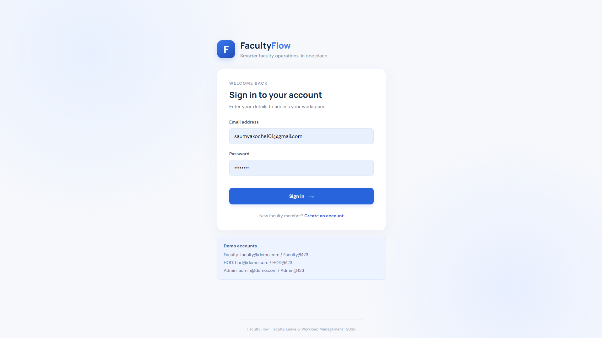
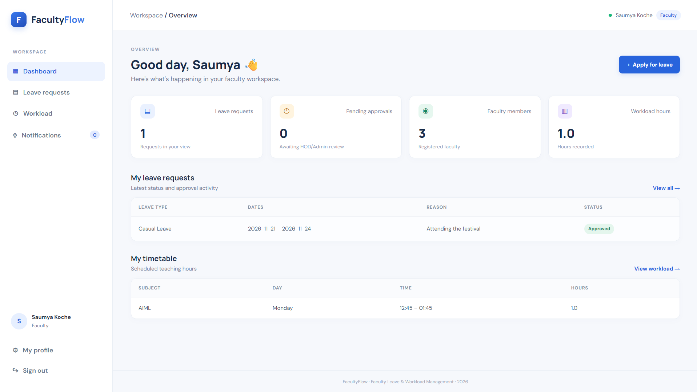
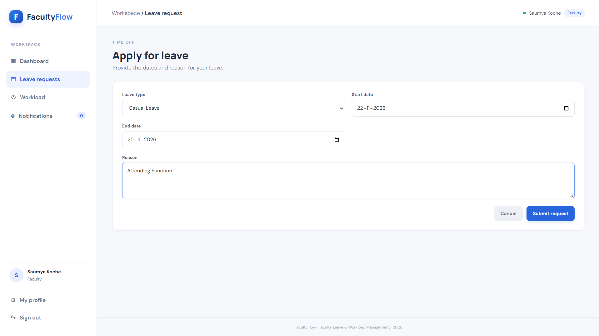
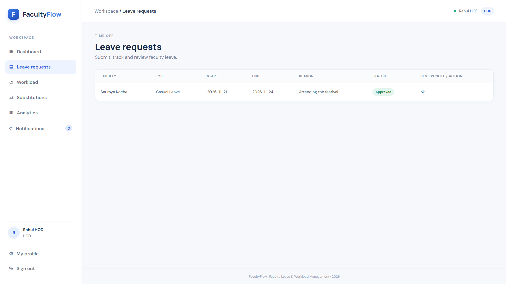
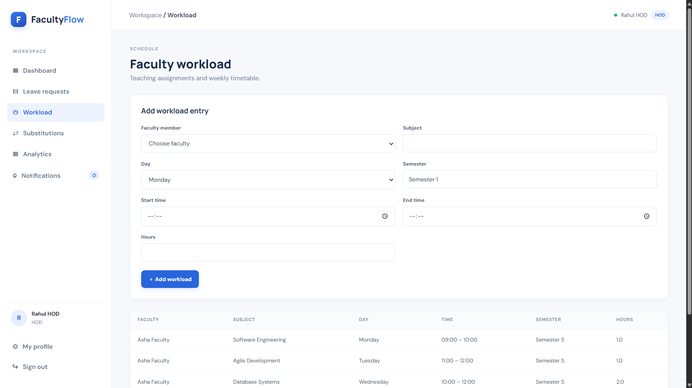

# FacultyFlow — Faculty Leave & Workload Management System

## Project Overview
FacultyFlow is a web-based application developed to simplify and manage faculty leave applications, approvals, workload distribution, and substitute allocation in an educational institution.

The system provides a centralized platform for faculty members and administrators to manage leave and workload activities efficiently.

## Objectives
- Simplify faculty leave application and approval.
- Maintain faculty workload and timetable information.
- Manage substitute faculty allocation.
- Provide notifications about leave request status.
- Generate monthly workload reports.

## Key Features
1. **User Authentication:** Faculty registration and login.
2. **Faculty Dashboard:** View personal information and dashboard details.
3. **Leave Management:** Apply for, edit, and track leave requests.
4. **Approval Management:** HOD/Admin can approve or reject leave requests.
5. **Workload Management:** Manage faculty timetable and workload.
6. **Substitute Allocation:** Assign replacement faculty members.
7. **Notifications:** Display leave status updates.
8. **Analytics:** View monthly workload reports.

## Technologies Used
- **Frontend:** HTML, CSS
- **Backend:** Python, Flask
- **Database:** SQLite
- **Development Tool:** Visual Studio Code
- **Version Control:** Git and GitHub

## Installation and Setup

1. Clone the repository:

   ```bash
   git clone https://github.com/saumyakoche101/Faculty_Management_System.git
   ```

2. Open the project folder:

   ```bash
   cd Faculty_Management_System
   ```

3. Create a virtual environment:

   ```bash
   python -m venv .venv
   ```

4. Activate the environment on Windows:

   ```bash
   .venv\Scripts\activate
   ```

5. Install dependencies:

   ```bash
   pip install -r requirements.txt
   ```

6. Run the application:

   ```bash
   python app.py
   ```

7. Application Link:

   `https://facultyflow-w7hy.onrender.com`

## Project Structure

```text
Faculty_Management_System/
│
├── app.py
├── requirements.txt
├── README.md
├── .gitignore
│
├── static/
│   └── css/
│
└── templates/
    ├── login.html
    ├── register.html
    ├── dashboard.html
    ├── leaves.html
    ├── workload.html
    └── ...
```

## Future Enhancements
- Email notifications.
- Export workload reports to PDF or Excel.
- Improved role-based access control.
- Deployment on a cloud platform.

## Author
**Developed as a College Academic Project.**

## Application Screenshots

### 1. Faculty Login


### 2. Faculty Dashboard


### 3. Leave Application


### 4. HOD Leave Approval


### 5. Faculty Workload

